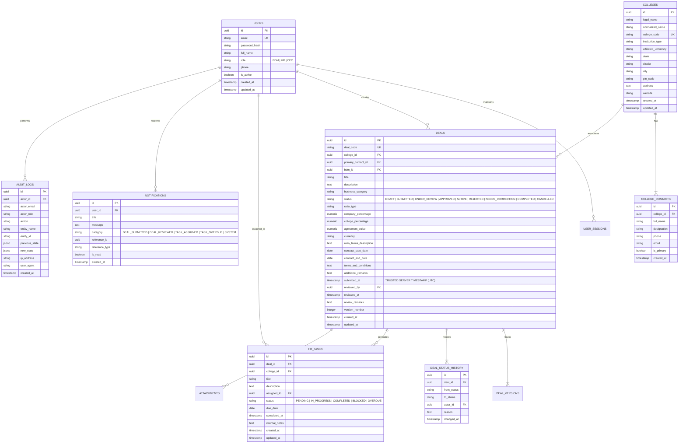

# College Business Deal Management & Executive Dashboard Platform
## Architecture & Technical Design Document

**Document Version:** 1.0.0  
**Status:** Approved for Implementation  
**Architecture Style:** Layered Modular Monolith (Clean Architecture)  

---

## 1. System Architecture Overview

```
                                      +---------------------------------------------+
                                      |                CLIENT LAYER                 |
                                      |  Next.js 15+ App Router, React 19, Tailwind |
                                      |  Lucide Icons, Recharts, Responsive UI      |
                                      +----------------------+----------------------+
                                                             |
                                                       HTTPS / JSON
                                                             |
                                      +----------------------v----------------------+
                                      |               SECURITY LAYER                |
                                      |  - HTTP-only Signed Session Cookies         |
                                      |  - Server-side RBAC Guard Middleware        |
                                      |  - Rate Limiter (Token Bucket / Memory)     |
                                      |  - Input Validation via Zod Schemas         |
                                      |  - CSRF Header Protection                   |
                                      +----------------------+----------------------+
                                                             |
                                      +----------------------v----------------------+
                                      |              APPLICATION LAYER              |
                                      |  - AuthService         - DealService        |
                                      |  - CollegeService      - HRTaskService      |
                                      |  - KPIService          - ExportService      |
                                      |  - AuditService        - NotificationService|
                                      +----------------------+----------------------+
                                                             |
                                      +----------------------v----------------------+
                                      |                DOMAIN LAYER                 |
                                      |  - Deal State Machine (Pure Transition Fns) |
                                      |  - Commercial Ratio Normalizer & Invariants |
                                      |  - Entity Models & Value Objects            |
                                      +----------------------+----------------------+
                                                             |
                                      +----------------------v----------------------+
                                      |             PERSISTENCE LAYER               |
                                      |  - PostgreSQL 18 Relational Database        |
                                      |  - Connection Pool (pg.Pool)                |
                                      |  - ACID Transaction Execution Engine        |
                                      |  - Version-Controlled SQL Migrations        |
                                      +---------------------------------------------+
```

---

## 2. Relational Schema & Entity-Relationship (ER) Design

### 2.1 Database Tables & Constraints



---

## 3. Server-Enforced RBAC & Record-Level Authorization

| Operation | Resource | BDM | HR | CEO | Enforcement Layer |
|---|---|:---:|:---:|:---:|---|
| `POST /api/auth/login` | Session | Allow | Allow | Allow | Public Rate-limited |
| `GET /api/colleges` | College Directory | Allow | Allow | Allow | Authenticated Session |
| `POST /api/colleges` | College Creation | Allow | Allow | Allow | Authenticated Session |
| `GET /api/deals` | Deal List | **Own Deals Only** | **All Deals** | **All Deals** | Filtered by SQL `WHERE bdm_id = $auth_id` |
| `GET /api/deals/:id` | Deal Details | **Own Deals Only** | Allow | Allow | Record-level Ownership Check |
| `POST /api/deals` | Create Draft Deal | **Allow** | Deny | Deny | BDM Role Check |
| `PUT /api/deals/:id` | Update Draft / Correction | **Own Drafts / Needs Correction** | Deny | Deny | State & Ownership Check |
| `POST /api/deals/:id/submit` | Submit Deal | **Own Deals in DRAFT/CORRECTION** | Deny | Deny | State & Server Timestamp |
| `POST /api/deals/:id/review` | Mark Under Review | Deny | Deny | **Allow** | CEO Role Check |
| `POST /api/deals/:id/approve` | Approve Deal | Deny | Deny | **Allow** | CEO Role Check |
| `POST /api/deals/:id/reject` | Reject Deal | Deny | Deny | **Allow** | CEO Role Check (Reason required) |
| `POST /api/deals/:id/request-correction` | Return for Correction | Deny | Deny | **Allow** | CEO Role Check (Remarks required) |
| `GET /api/hr-tasks` | HR Task List | Deny | **Allow** | **Allow** | Role Check |
| `POST /api/hr-tasks` | Create HR Task | Deny | **Allow** | **Allow** | Role Check |
| `PATCH /api/hr-tasks/:id` | Update Operational Task | Deny | **Allow** | **Allow** | Role Check |
| `GET /api/dashboard/kpis` | KPI Aggregates | **BDM Scoped** | **HR Scoped** | **Organization Scoped** | Filtered query per Role |
| `GET /api/reports/export` | CSV / Excel Export | **Own Deals** | **Operational Data** | **Full Audit & Deals** | Export Sanitization & Audit Log |
| `GET /api/audit-logs` | Security & Deal Audit | Deny | Deny | **Allow** | CEO Only |
| `GET /api/users` | User Directory | Deny | Deny | **Allow** | CEO Only |

---

## 4. Deal State Machine Specifications

```
                     +-----------------------------+
                     |            DRAFT            |
                     +--------------+--------------+
                                    |
                            submit() (BDM only)
                            [Server timestamp attached]
                                    |
                                    v
                     +-----------------------------+
      +------------->|          SUBMITTED          |<------------+
      |              +--------------+--------------+             |
      |                             |                            |
      |               review() (CEO)|                            |
      |                             v                            |
      |              +-----------------------------+             |
      |              |        UNDER_REVIEW         |             |
      |              +----+---------+---------+----+             |
      |                   |         |         |                  |
      |  request_correction()       |         | reject() (CEO)   |
      |                   |         |         |                  |
      |                   v         |         v                  |
+-----+--------------+  +-----------|----+  +--------------------+
|  NEEDS_CORRECTION  |  |           |    |  |      REJECTED      |
+--------------------+  |           |    |  +--------------------+
                        |           |
                        | approve() (CEO)
                        |           |
                        v           v
                     +-----------------------------+
                     |          APPROVED           |
                     +--------------+--------------+
                                    |
                           onboard() / start_date
                                    |
                                    v
                     +-----------------------------+
                     |           ACTIVE            |
                     +--------------+--------------+
                                    |
                           term_end() / complete()
                                    |
                                    v
                     +-----------------------------+
                     |          COMPLETED          |
                     +-----------------------------+
```

---

## 5. Security & Threat Modeling (STRIDE)

| Threat Category | Potential Attack Vector | Platform Mitigation Architecture |
|---|---|---|
| **Spoofing** | Session token hijacking, fabricated user identity | Cryptographically random UUID v4 sessions stored in DB, HTTP-only Secure SameSite cookies, session invalidation on logout. |
| **Tampering** | Modifying client-side deal submission timestamps or owner ID | Backend ignores all client timestamps, generating UTC `submitted_at` during PostgreSQL commit transaction; `bdm_id` is assigned directly from validated server session. |
| **Repudiation** | Denying approval, rejection, or commercial term amendments | Immutable `deal_status_history` and `audit_logs` capturing actor ID, previous/new state diffs, IP address, user-agent, and reason. |
| **Information Disclosure** | IDOR on deals; Horizontal privilege escalation between BDMs | SQL queries strictly enforce tenancy predicates: `WHERE bdm_id = $session.userId` for BDM roles; direct record queries verify ownership before returning entity. |
| **Denial of Service** | Exhaustion of DB pool via unthrottled exports or login spam | Rate limiting on auth endpoints (5 req/15min) and export endpoints; DB connection pooling with explicit timeouts. |
| **Elevation of Privilege** | BDM attempting to approve deal or elevate role | Backend enforces role checks in middleware and individual service handlers; role enum cannot be modified through user update endpoints. |
| **CSV / Formula Injection** | Malicious formula payloads (`=cmd|' /C ...'`) in college names or descriptions | Export service sanitizes all string output cells by escaping leading formula trigger characters (`=`, `+`, `-`, `@`, `\t`, `\r`). |
